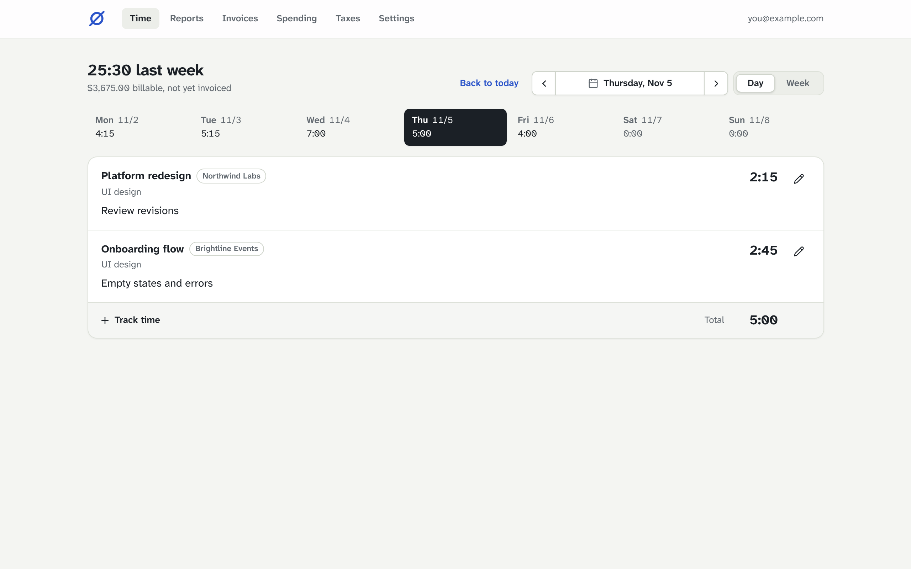
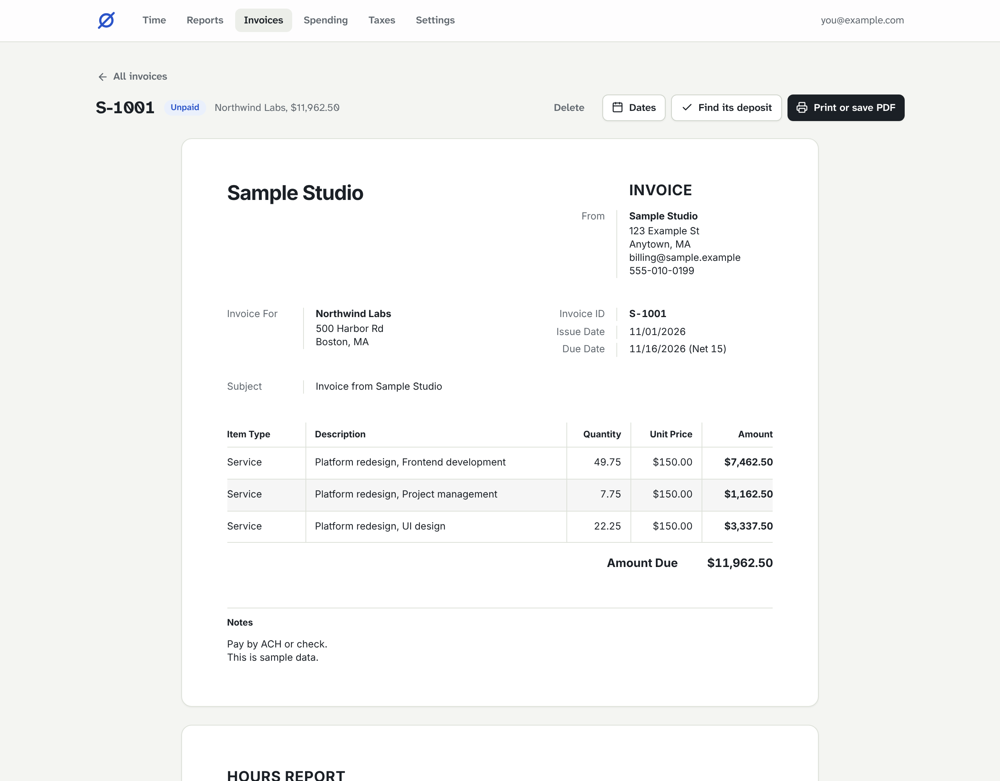
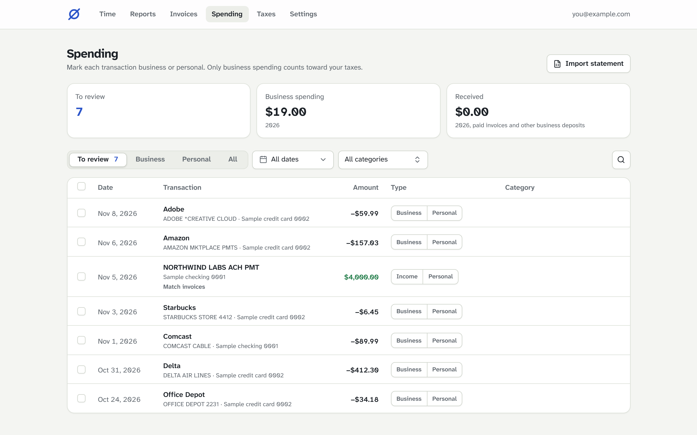
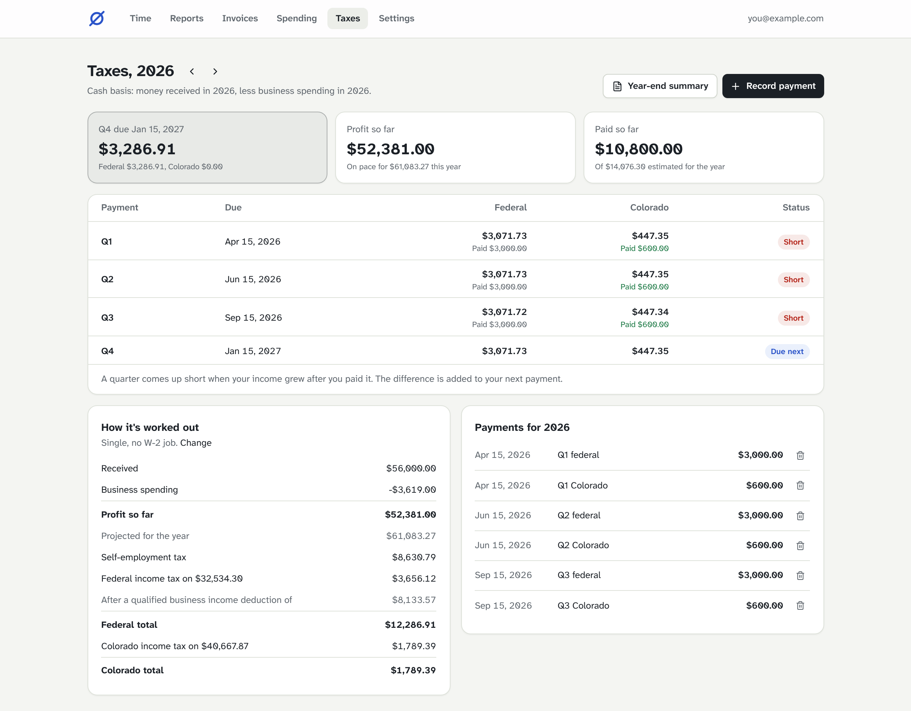

# Zero Overhead

The freelance back office you own. Track your hours, send invoices, sort your bank and card spending, and estimate quarterly taxes, in one small app that runs in your own Cloudflare account. No subscription, and your data never leaves your account.

[](https://deploy.workers.cloudflare.com/?url=https://github.com/erikbettencourt/zero-overhead)



## Who it's for

Solo freelancers and consultants in the US, sole proprietors and single-member LLCs, who **bill by the hour**. You log time, invoices bill the hours, and the app works out what you owe in taxes.

Not supported yet: fixed-fee projects, deposits and payment schedules, and businesses outside the US.

## What it does

- **Time.** A day and week view by client, project and task, with notes on every entry. Import your history from Harvest.
- **Reports and invoices.** Hours and earnings for any period. Invoices bill a client's uninvoiced hours, lock them, and print as a PDF with the hours report on page 2.
- **Transactions.** Everything from your bank and cards, downloaded nightly through [Plaid](https://plaid.com) or imported from statement CSV files. Mark each one business or personal, file business spending under its Schedule C line, and let rules sort the regulars. Business-only accounts and transfers between your accounts are handled too. Import your history from QuickBooks Self-Employed.
- **Getting paid.** Match each deposit to the invoice it paid (or several, when a client pays them together). The deposit's date is the paid date, so income lands in the year the money arrived.
- **Taxes.** Quarterly federal and state estimates for every state, from what you've been paid and what you've spent, with your payments tracked against each due date. At year end, a one-page summary for your accountant, as a PDF and a CSV.

| Invoices | Transactions | Taxes |
| --- | --- | --- |
|  |  |  |

## What it costs

Cloudflare's free plans cover one person's use: the Worker, the D1 database, R2 for backups, and Access for the login. The only cost is a domain, if you don't already have one on Cloudflare. Bank sync through Plaid is optional; without it, you import statements instead.

## Get started

1. **[Set it up](docs/setup.md).** About 30 minutes: the Deploy to Cloudflare button above, your domain, and a login with Cloudflare Access.
2. **[Bring in your money](docs/bank.md).** Connect banks through Plaid, or import statements.
3. **[Stay up to date](docs/updating.md).** A workflow in your copy opens a pull request when there's a new version. The app also says **Update available** when there is one.

## How it's secured

1. **Cloudflare Access** sits in front of the app. Nobody reaches it without signing in through the identity provider you choose.
2. **The Worker checks every request again.** It verifies the signed Access token (issuer, audience and allowed email) before serving anything, including the app's own files. If the app isn't configured, it refuses all requests.
3. **No side doors.** The `workers.dev` and preview addresses are turned off, so your own domain is the only way in.
4. **Bank logins are encrypted at rest** with `BANK_TOKEN_KEY`, a secret only the Worker holds. They're read-only Plaid tokens, and they're never included in a downloaded backup.

## Backups and restore

Three layers, from most recent to oldest:

1. **Time Travel** (built into D1, always on). Roll the database back to any minute in the last 7 days (30 on the Workers Paid plan). Best for "I just deleted something".
   ```sh
   npx wrangler d1 time-travel info zero-overhead            # what's available
   npx wrangler d1 time-travel restore zero-overhead --timestamp=2027-03-01T09:00:00Z
   ```
   A restore prints a bookmark for the state it replaced, so a restore can itself be undone.
2. **Nightly backups in R2.** Every night at 09:17 UTC (early morning in the US; change the cron in `wrangler.jsonc` to move it) the Worker saves the whole database to the `zero-overhead-backups` bucket: the last 90 nights in `daily/`, and the first backup of each month for 7 years in `monthly/`. Settings › Data shows the last backup and lets you download any of them, or back up now.
3. **Your own copies.** Settings › Data › Download a copy saves everything to a file. Keep one somewhere outside Cloudflare now and then.

**To restore from a backup file** (replaces everything in the database with the file's contents):

```sh
# 1. Get the file: download it from Settings › Data, or straight from R2
npx wrangler r2 object get zero-overhead-backups/daily/2027-03-01.json --file backup.json --remote

# 2. Turn it into SQL, then run it against the database
node scripts/restore.mjs backup.json > restore.sql
npx wrangler d1 execute zero-overhead --remote --file restore.sql
```

A backup knows which version of the database it came from. If it's newer than your app, the restore stops before changing anything with `backup_is_from_a_newer_version_update_the_app_first`: update the app, then run it again.

To rehearse first, run step 2 with `--local` instead of `--remote`, then `npm run dev` and look around. Nightly backups include the encrypted bank logins, so banks keep syncing after a restore as long as `BANK_TOKEN_KEY` is unchanged. A downloaded copy leaves them out, so after restoring from one, connect each bank again.

## Development

Node 20 or later.

```sh
npm install
cp .dev.vars.example .dev.vars
npm test          # unit and API tests against a local database
npm run build
```

The app is a Cloudflare Worker (`worker/`) serving a React app (`src/`), with shared logic in `shared/` and the database schema in `migrations/`. See [CONTRIBUTING.md](CONTRIBUTING.md) to help out, and [docs/tax-figures.md](docs/tax-figures.md) to add a year's tax figures.

## Disclaimer

Tax figures are estimates to help you plan, not tax advice. Check them with your accountant.

## License

[MIT](LICENSE)
